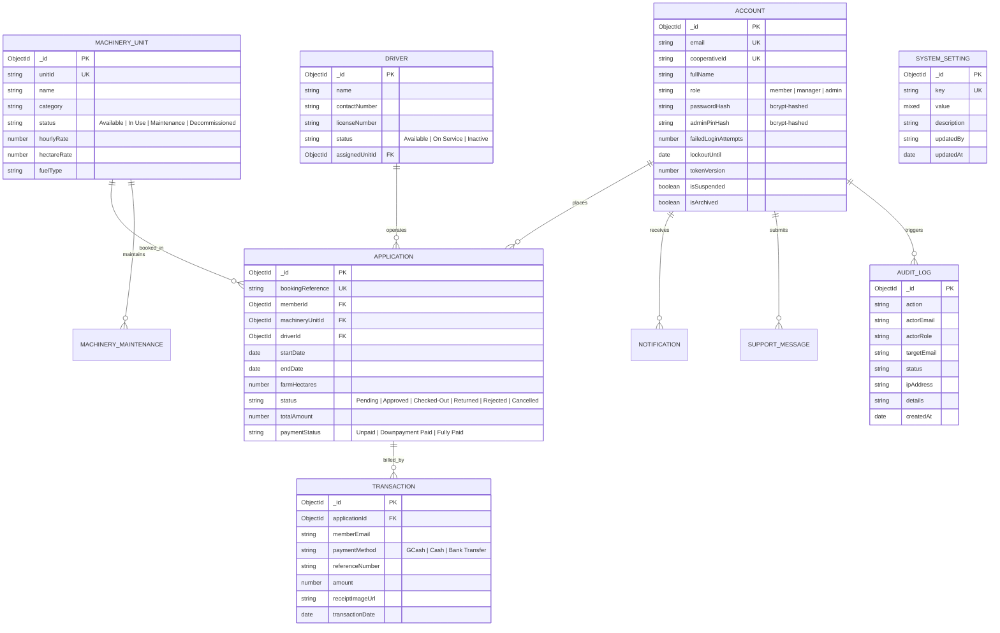

# KIMPC Machinery Portal - Database Architecture & Schema Guide

> **Kalilangan Irrigators Multi-Purpose Cooperative (KIMPC)**  
> **Database:** MongoDB Atlas (Database Name: `minders`)  
> **Object Data Modeling (ODM):** Mongoose  
> **Document Version:** 2.0 (November 2026)  
> **Audience:** Present & Future Software Engineers, System Maintainers, and Database Administrators.

---

## 1. High-Level Architecture & Entity Relationships

The KIMPC database is designed around cooperative machinery rentals, member bookings, equipment inventory, financial transactions, and immutable audit logs.



---

## 2. Directory & File Organization

All database-related code is cleanly modularized inside the `server/` folder:

```text
server/
├── config/
│   └── database.js               # MongoDB connection pool & reconnection logic
├── models/
│   ├── index.js                  # Central registry exporting all models
│   ├── Account.js                # Users (Admins, Managers, Members)
│   ├── Application.js            # Machinery rental booking requests
│   ├── AuditLog.js               # Security and compliance audit log
│   ├── Driver.js                 # Equipment operators & driver licenses
│   ├── MachineryMaintenance.js   # Equipment repair and maintenance logs
│   ├── MachineryUnit.js          # Tractor & harvester inventory
│   ├── MachineryUsage.js         # Equipment hour meter & usage tracking
│   ├── Notification.js           # In-app member & staff notifications
│   ├── SupportMessage.js         # Customer support and inquiry tickets
│   ├── SystemSetting.js          # Dynamic third-party toggle settings
│   └── Transaction.js            # Payments, receipts & financial ledger
├── scripts/
│   └── db-inspect.js             # CLI inspection & health-check tool (`npm run db:check`)
├── workers/
│   ├── archiveAuditLogs.js       # Monthly worker archiving old audit logs to disk
│   └── bookingReminderNotifications.js # Daily 8:00 AM notification cron
├── seed.js                       # Initial demo accounts seeder (`npm run seed`)
└── DATABASE_SCHEMA.md            # This document
```

---

## 3. Data Dictionary (Collections & Field Definitions)

### A. `accounts` Collection (Model: `Account`)
Stores all cooperative users (administrators, operations managers, and cooperative farmer members).

| Field Name | Type | Required | Default | Description / Purpose |
| :--- | :--- | :---: | :--- | :--- |
| `_id` | `ObjectId` | Yes | Auto | Unique MongoDB document identifier. |
| `email` | `String` | Yes | — | Unique, lowercase email address. Unique index. |
| `cooperativeId` | `String` | Yes | — | Sequential Member ID (e.g. `M260001`). Unique index. |
| `fullName` | `String` | Yes | — | Full legal name of the user. |
| `role` | `String` | Yes | `'member'` | User access level: `'member'`, `'manager'`, or `'admin'`. |
| `passwordHash` | `String` | Yes | — | Salted **bcrypt** (10 rounds) one-way hash of password. |
| `adminPinHash` | `String` | No | `null` | Salted **bcrypt** (10 rounds) hash for Admin 6-Digit PIN. |
| `failedLoginAttempts` | `Number` | No | `0` | Consecutive failed password entries. Locks at 5. |
| `lockoutUntil` | `Date` | No | `null` | Expiration timestamp for temporary 15-minute lock. |
| `tokenVersion` | `Number` | No | `0` | Incremented upon password reset to revoke existing JWTs. |
| `emailVerified` | `Boolean` | No | `false` | Verification status of member's email address. |
| `verificationStatus` | `String` | No | `'pending'` | Status: `'pending'`, `'verified'`, or `'declined'`. |
| `isSuspended` | `Boolean` | No | `false` | Administrative deactivation / suspension toggle. |
| `suspensionReason` | `String` | No | `""` | Note explaining reason for account suspension. |
| `isArchived` | `Boolean` | No | `false` | Soft-deletion flag moving account to archive folder. |
| `googleOAuth` | `Object` | No | `{}` | OAuth refresh & access tokens for Google Calendar sync. |

---

### B. `applications` Collection (Model: `Application`)
Stores machinery reservation and agricultural service requests made by members.

| Field Name | Type | Required | Default | Description / Purpose |
| :--- | :--- | :---: | :--- | :--- |
| `_id` | `ObjectId` | Yes | Auto | Unique document identifier. |
| `bookingReference` | `String` | Yes | Auto | Public tracking code (e.g. `BK-2026-0042`). |
| `memberId` | `ObjectId` | Yes | — | Foreign Key referencing `accounts._id`. |
| `machineryUnitId` | `ObjectId` | Yes | — | Foreign Key referencing `machineryunits._id`. |
| `driverId` | `ObjectId` | No | `null` | Foreign Key referencing `drivers._id`. |
| `farmHectares` | `Number` | Yes | `1` | Area of farm land to be serviced. |
| `farmLocation` | `String` | Yes | — | Farm sitio/barangay location within Kalilangan. |
| `coordinates` | `Object` | No | `{}` | GeoJSON/lat-lng for GPS mapping. |
| `startDate` | `Date` | Yes | — | Scheduled service start date. |
| `endDate` | `Date` | Yes | — | Scheduled service completion date. |
| `status` | `String` | Yes | `'Pending'` | Lifecycle: `'Pending'`, `'Approved'`, `'Checked-Out'`, `'Returned'`, `'Rejected'`, `'Cancelled'`. |
| `totalAmount` | `Number` | Yes | `0` | Calculated rental fee in Philippine Pesos (PHP). |
| `downpaymentAmount` | `Number` | No | `0` | Required 25% booking deposit. |
| `paymentStatus` | `String` | Yes | `'Unpaid'` | Status: `'Unpaid'`, `'Downpayment Paid'`, `'Fully Paid'`. |

---

### C. `machineryunits` Collection (Model: `MachineryUnit`)
The cooperative's physical inventory of heavy farm equipment.

| Field Name | Type | Required | Default | Description / Purpose |
| :--- | :--- | :---: | :--- | :--- |
| `_id` | `ObjectId` | Yes | Auto | Unique document identifier. |
| `unitId` | `String` | Yes | — | Physical asset tag (e.g. `TR-01`, `HV-02`). Unique. |
| `name` | `String` | Yes | — | Equipment name (e.g. *Kubota L5018 Tractor*). |
| `category` | `String` | Yes | — | Category: `'Tractor'`, `'Harvester'`, `'Planter'`, `'Dryer'`. |
| `status` | `String` | Yes | `'Available'` | Status: `'Available'`, `'In Use'`, `'Maintenance'`, `'Decommissioned'`. |
| `hourlyRate` | `Number` | No | `0` | Rate per operating hour (PHP). |
| `hectareRate` | `Number` | No | `0` | Standard billing rate per hectare (PHP). |
| `imageUrl` | `String` | No | `""` | Primary Cloudinary/Upload photo URL. |
| `fuelType` | `String` | No | `'Diesel'` | Fuel type consumed by the engine. |

---

### D. `drivers` Collection (Model: `Driver`)
Assigned cooperative operators and heavy equipment drivers.

| Field Name | Type | Required | Default | Description / Purpose |
| :--- | :--- | :---: | :--- | :--- |
| `_id` | `ObjectId` | Yes | Auto | Unique document identifier. |
| `name` | `String` | Yes | — | Full name of the operator. |
| `contactNumber` | `String` | Yes | — | Mobile phone number. |
| `licenseNumber` | `String` | No | `""` | Professional Driver's License number. |
| `status` | `String` | Yes | `'Available'` | Operational availability: `'Available'`, `'On Service'`, `'Inactive'`. |
| `assignedUnitId` | `ObjectId` | No | `null` | Reference to default `machineryunits._id`. |

---

### E. `transactions` Collection (Model: `Transaction`)
Financial ledger records verifying rental payments and downpayments.

| Field Name | Type | Required | Default | Description / Purpose |
| :--- | :--- | :---: | :--- | :--- |
| `_id` | `ObjectId` | Yes | Auto | Unique document identifier. |
| `applicationId` | `ObjectId` | Yes | — | Foreign Key referencing `applications._id`. |
| `memberEmail` | `String` | Yes | — | Email of paying cooperative member. |
| `paymentMethod` | `String` | Yes | `'GCash'` | Method: `'GCash'`, `'Cash'`, or `'Bank Transfer'`. |
| `referenceNumber` | `String` | Yes | — | Transaction reference (e.g. GCash Ref No). |
| `amount` | `Number` | Yes | `0` | Amount paid in PHP. |
| `receiptImageUrl` | `String` | No | `""` | Scanned or uploaded photo of the payment receipt. |
| `status` | `String` | Yes | `'Verified'` | Status: `'Pending Verification'`, `'Verified'`, `'Declined'`. |

---

### F. `auditlogs` Collection (Model: `AuditLog`)
Immutable security audit log documenting administrative, security, and financial operations.

| Field Name | Type | Required | Default | Description / Purpose |
| :--- | :--- | :---: | :--- | :--- |
| `_id` | `ObjectId` | Yes | Auto | Unique log document identifier. |
| `action` | `String` | Yes | — | Event code: `'USER_LOGIN'`, `'ADMIN_PIN_VERIFIED'`, `'ACCOUNT_LOCKED'`, `'DEV_AUTH_APPROVED'`, etc. |
| `actorEmail` | `String` | Yes | — | Email of user performing the action. |
| `actorRole` | `String` | Yes | — | Role at the time of the event (`'admin'`, `'manager'`, `'member'`). |
| `targetEmail` | `String` | No | `""` | Target account or resource affected. |
| `status` | `String` | No | `'Success'` | Event outcome: `'Success'`, `'Failed'`, `'Denied'`, `'Locked'`. |
| `ipAddress` | `String` | No | `""` | Remote IP address from request headers. |
| `details` | `String` | No | `""` | Human-readable explanation of the action. |
| `createdAt` | `Date` | Yes | `Date.now` | Indexed timestamp for temporal queries and archiving. |

---

### G. `systemsettings` Collection (Model: `SystemSetting`)
Dynamic portal configurations and third-party API integration switches.

| Field Name | Type | Required | Default | Description / Purpose |
| :--- | :--- | :---: | :--- | :--- |
| `key` | `String` | Yes | — | Configuration key (e.g. `'googleLoginEnabled'`). Unique index. |
| `value` | `Mixed` | Yes | — | Boolean toggle, numeric limit, or JSON config object. |
| `description` | `String` | No | `""` | Documentation explaining what this setting controls. |
| `updatedBy` | `String` | No | `'system'` | Admin email who last updated the toggle. |
| `updatedAt` | `Date` | Yes | `Date.now` | Last update timestamp. |

---

## 4. Security & Cryptographic Standards

1. **One-Way Password & PIN Hashing (`bcrypt`)**:
   - Neither account passwords nor 6-digit Admin PINs are ever stored in plain text.
   - All passwords use `bcrypt` with `saltRounds = 10`.
   - Admin 6-digit PINs are stored in `adminPinHash` using `bcrypt` (10 rounds).
2. **Brute-Force Rate Limiting & 5-Attempt Lockout**:
   - Consecutive wrong passwords increment `Account.failedLoginAttempts`.
   - On the 5th failed attempt, `Account.lockoutUntil` is set to `Date.now() + 15 minutes`.
   - During the 15-minute lockout, all attempts are blocked with `HTTP 429 Too Many Requests`.
   - A security alert email is automatically dispatched to the account owner.
   - Entering the correct password or signing in with Google immediately resets `failedLoginAttempts = 0`.
3. **Admin 6-Digit PIN Rate Limiting**:
   - 5 failed PIN attempts lock the administrative security PIN for 15 minutes and trigger an `ADMIN_PIN_LOCKED` audit log.
4. **System Developer Dual-Control Integration Security**:
   - Any modification to API keys or OAuth toggles requires:
     1. Admin 6-digit PIN verification.
     2. System Developer (`SYSTEM_DEVELOPER_EMAIL`) approval via a signed 32-byte cryptographic token or 6-digit Developer OTP.
     3. Requests strictly expire after 15 minutes.
5. **Session Invalidation (`tokenVersion`)**:
   - Whenever a user resets or changes their password, `Account.tokenVersion` increments by 1, instantly revoking all active JWTs.

---

## 5. Developer Maintenance & CLI Commands

Future developers can manage and inspect the database using these built-in npm commands from the `server/` directory:

### Inspect Database Health & Live Collections
```bash
npm run db:check
```
*Outputs cluster latency, total documents across all collections, breakdown of users, machinery status, and integration switches.*

### Seed Initial Demo Accounts
```bash
npm run seed
# or
npm run db:seed
```
*Creates initial demo Administrator (`admin@kimpc.test`), Manager (`manager@kimpc.test`), and Member (`demo.member@kimpc.test`) accounts.*

### Automated Monthly Audit Log Archiving
A background cron worker ([`server/workers/archiveAuditLogs.js`](file:///c:/Users/DELL%20RTX/OneDrive/Documents/pads/BUKSU/Merge%20Project/minders/server/workers/archiveAuditLogs.js)) automatically runs at **12:05 AM on the 1st day of every month**, exports logs older than 90 days to `server/archive/audit-logs/`, and keeps the database performant and lean.

---

## 6. Backup & Recovery (`mongodump` / `mongorestore`)

To create an off-site backup of the entire cooperative database:

```bash
# Export full database dump
mongodump --uri="<MONGODB_URI>" --out=./backup/$(date +%Y-%m-%d)

# Restore from a backup dump
mongorestore --uri="<MONGODB_URI>" ./backup/YYYY-MM-DD/minders
```

---
*Maintained by KIMPC Engineering & Development Team.*

